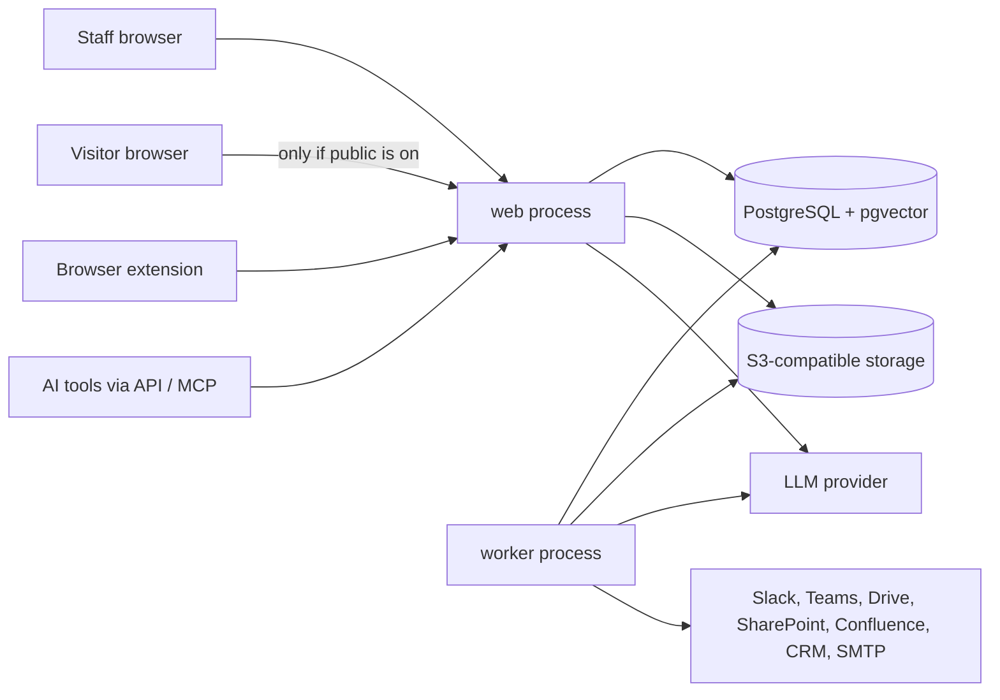

# Spec: security-assurance-portal

From: intent.md (accepted 2026-11-11, amended with A14). Status: ready for owner review.
Skills applied: license-policy, security-baseline, simplicity, ux-principles, ai-answer-integrity, testing.
Facts in this spec were checked at their sources on 2026-11-11 unless marked "not verified".

## Summary

One Python application (Django, server-rendered pages) with PostgreSQL and S3-compatible storage. It has three parts that a deployer can switch on independently:

| Part | Setting | Default | What it is |
|---|---|---|---|
| Response management | `RESPONSE_ENABLED` | on | Questionnaire import, cited AI drafts, review, export |
| Trust center for staff | `TRUST_CENTER_ENABLED` | on | Portals that signed-in staff browse and use to serve their clients |
| Public trust center | `PUBLIC_PORTAL_ENABLED` | **off** | The same portals on the public internet, with visitor access requests and Q&A |

A part that is off has no routes and no menu entry. All three share one knowledge base, one retrieval function and one authorization module.

**Decisions on the intent's open questions**

1. **Reuse: build new.** Probo is MIT and its trust portal is mature, but it is a full GRC suite of about 854,000 lines of Go and 311,000 lines of TypeScript, with no questionnaire engine, no visitor Q&A and no vector search. Forking it means owning all of that; running it alongside means two apps. We use it only as a behavior reference (for example its public/restricted document states and its requested → granted → rejected → revoked access flow). We copy no code and none of its two CC BY-SA 4.0 data files.
2. **Language: Python only, no parsing worker.** Permissive Python libraries cover Excel, Word and text PDFs. Docling is left out: it needs PyTorch and two of its default models are under CDLA-Permissive-2.0, which is not on the allowed list.
3. **LLM: one interface, two providers.** Anthropic, and any OpenAI-compatible endpoint (which also covers self-hosted models). Embeddings come from a small local model, so no second key is needed and document text is not sent out for indexing.
4. **Framework content: ship none.** CAIQ, SIG, HECVAT and VSA terms all bar redistribution or platform use without a license. The deployer imports their own licensed copy.
5. **Portal fill-back: one generic extension**, not per-portal adapters. The deployer is responsible for each portal's terms.

## Requirements

Every requirement is built. "A2+" means the scenario needs the small extension proposed under Concerns (C8).

| ID | Requirement | Scenario |
|---|---|---|
| **Knowledge base** | | |
| R1 | Library answers: question, answer, attachments, owner, tags, audience (public, NDA, internal), review date, framework IDs | A1 |
| R2 | Answers and sources have states: draft → approved → archived. Only approved content is retrievable | A1 |
| R3 | Version history for every answer and source, with who and when | A1 |
| R4 | Content past its review date is flagged everywhere it appears and lowers confidence | A1 |
| R5 | Possible duplicates are flagged when an answer is saved; contradicting answers are flagged to their owners | A1 |
| R6 | Source documents (PDF, Word, Excel, text, HTML) are uploaded, split into passages and indexed for keyword and meaning search | A1 |
| R7 | Import an existing answer library from a spreadsheet | A1+ |
| R8 | Sync sources from Google Drive, SharePoint and Confluence. Synced items arrive unapproved with a default audience; items removed upstream are archived | A9 |
| **Response management** | | |
| R9 | Import Excel (multi-tab, merged cells), CSV, Word and text PDF. The app proposes which cells or paragraphs are questions and where answers go; the user confirms on a preview | A2 |
| R10 | Draft every question from approved content only, with at least one citation whose quoted text is checked to exist in the source | A2 |
| R11 | A question without enough support becomes "Needs expert" with the reason. No model call fills the gap | A2, A3 |
| R12 | Each draft shows a confidence level (High, Medium, Needs expert) and the reasons | A2 |
| R13 | Projects: assign questions, due dates, comments, status counts (drafted, needs expert, in review, approved) | A2+ |
| R14 | Review: a reviewer approves or edits each answer. Only approved answers are exported | A2 |
| R15 | Export: Excel and CSV answers are written into the original file; Word answers into the original document; PDF questionnaires get a filled form if the PDF has form fields, otherwise an answer document in the original order | A2 |
| R16 | Narrative export of a project to Word and PDF | A2+ |
| R17 | Expert requests by Slack and Teams with a link to a one-question answer page; reminders before the due date | A3 |
| R18 | An expert's approved answer can be promoted to the library in one action | A3 |
| R19 | A questionnaire that carries framework IDs is matched by ID first. The deployer can import a framework file they are licensed to use | A2+ |
| R20 | Browser extension (Chromium): reads question fields on a web page, fills approved answers, never submits | A12 |
| **Trust center** | | |
| R21 | Portals with name, logo, accent color and exposure (internal or public). Sections: overview, certifications, policies, subprocessors with filter, FAQs, updates | A10, A14 |
| R22 | Documents are public or restricted per portal | A4 |
| R23 | Public mode: a visitor verifies their email, requests access, click-signs the NDA, and an approver grants or rejects | A4 |
| R24 | Grants expire, can be revoked, and both take effect on the next request | A4 |
| R25 | Every download is logged. PDF downloads of restricted documents are watermarked with the recipient | A4, A14 |
| R26 | Q&A answers only from approved content the asker's audience may see, with citations | A5, A14 |
| R27 | Staff self-service: any signed-in staff member browses portals, asks Q&A for a chosen client audience (public or NDA), and takes documents for a named client. Internal-only content is never offered | A14 |
| R28 | With public exposure off, no trust center route is reachable without a staff sign-in | A14 |
| R29 | Each public portal is served on its own domain. Staff routes do not exist on portal domains | A10 |
| R30 | Updates feed with email subscription (confirmed opt-in, one-click unsubscribe) | A10 |
| R31 | Analytics by account: visits, document views, downloads, requests, hand-overs | A11 |
| R32 | Accounts are matched by email domain to a Salesforce account and a HubSpot company, with a link to each | A11 |
| **Platform** | | |
| R33 | Staff sign in through OIDC or SAML. There are no local passwords | A6 |
| R34 | SCIM 2.0 creates, updates and deactivates users and maps groups to roles | A6 |
| R35 | Roles: admin, editor, reviewer, viewer, portal approver. One central permission check, deny by default | A6 |
| R36 | Append-only audit log of sign-ins, permission changes, approvals, grants, revocations, hand-overs, exports and which content was sent to which LLM provider. Admins view and export it | A7 |
| R37 | REST API with an OpenAPI document and per-user tokens | A8 |
| R38 | MCP server (read-only): search approved answers, get an answer, ask a cited question | A8 |
| R39 | Each part can be switched off; an off part has no routes | A14 |
| R40 | Install with one documented command; schema upgrades keep data; backup and restore are documented | A13 |
| R41 | Accessibility to WCAG 2.2 AA on staff and portal pages | all (automated checks) |
| R42 | Rate limits on sign-in, access requests, Q&A, downloads and the API | A4, A5 |

## Parity matrix

Competitor features are from the vendors' own pages.

| Capability | Who has it | Ours |
|---|---|---|
| Answer library with owners and review cycles | Loopio, Responsive | R1–R5 |
| Import from Excel, Word, PDF | Loopio, Responsive | R9 (text PDFs only; scanned PDFs not built) |
| AI drafts with citations and confidence | Loopio, Responsive, Conveyor | R10–R12 |
| Export in the original format | Loopio, Responsive | R15 |
| Expert collaboration in chat tools | Loopio, Responsive | R17 (link to an answer page, not in-chat answering) |
| Browser extension that fills buyer portals | Loopio (SmartFill for Portals) | R20 |
| MCP server over approved content | Loopio, Responsive | R38 |
| Trust center with NDA, approvals, watermarking | Responsive, Vanta, Drata/SafeBase, Conveyor, Probo | R21–R25 |
| Visitor AI Q&A over approved content | Vanta, Drata, Responsive | R26 |
| Multiple portals, custom domains, updates feed | Probo | R21, R29, R30 |
| CRM-linked analytics | Vanta (Salesforce, HubSpot), Drata (Salesforce) | R31, R32 (account link; no revenue reporting) |
| Staff SSO and SCIM | Probo and the commercial tools | R33, R34 |
| Internal self-service for client-facing staff | not offered as a separate mode by the tools checked | R27, R28 |
| Standard framework content built in | Commercial tools (licensed) | not built: licenses bar it; deployer imports (R19) |

## Architecture

- **One image, two processes.** `web` serves pages, the API and MCP. `worker` runs background jobs and scheduled jobs from a queue stored in PostgreSQL. Both run the same code.
- **Pages are server-rendered** with Django templates and htmx. No single-page app and no JavaScript build step. The browser extension is plain JavaScript in its own folder.
- **Host-based routing.** The staff console lives on one hostname. Each public portal domain gets only the public routes, and only when `PUBLIC_PORTAL_ENABLED` is on.
- **MCP** uses the official SDK, mounted next to Django by a thin outer ASGI file, because Django's own ASGI handler cannot run the SDK's lifespan.

**Modules** (one Django app each)

| Module | Owns |
|---|---|
| `accounts` | Staff users, roles, SSO, SCIM, API tokens, the permission check |
| `library` | Answers, sources, passages, versions, review dates, duplicates and conflicts, framework IDs |
| `ai` | The LLM interface, retrieval, drafting, citation check, confidence, recorded responses |
| `questionnaires` | Projects, import, questions, review, export, expert requests |
| `portal` | Portals, content, documents, visitors, access requests, NDA, grants, hand-overs, Q&A, subscriptions, analytics |
| `integrations` | One folder per service: Slack, Teams, Drive, SharePoint, Confluence, Salesforce, HubSpot |
| `audit` | The append-only log |
| `api` | REST endpoints and the MCP server |

**Data model outline**

- `User(role)`, `ApiToken(hash)`
- `Answer`, `AnswerVersion`, `Source`, `SourceVersion`, `Passage(text, search vector, embedding, location)`, `FrameworkItem`
- `Project`, `Question(location in file)`, `Draft(text, confidence, reasons, status)`, `Citation(draft → passage or answer, quoted text)`, `Comment`, `ExpertRequest`
- `Portal(exposure, domain, branding)`, `PortalItem`, `PortalDocument(visibility)`, `Update`, `Subscriber`
- `Account(domain, CRM links)`, `Visitor(email)`, `AccessRequest`, `NdaSignature(text hash, name, time, IP)`, `Grant(expires, revoked, granted_by)`, `Download`, `Event`
- `AuditEvent` (database trigger refuses updates and deletes)

**Key flows**

*Drafting an answer (questionnaires and Q&A use the same path)*
1. The caller states the audience. For a project it is the project's audience (NDA by default). For a visitor it is public, or NDA if they hold a live grant. For staff self-service it is the audience the staff member picked.
2. `retrieve(question, audience)` is the only function that reads content for AI. Its SQL filters on approved status and audience before ranking by keyword and meaning.
3. If the best support is below the threshold, the result is "Needs expert" and no model is called.
4. Otherwise the model receives the question and the passages as delimited data, and must return an answer with quoted passages, or "insufficient".
5. Code checks every quote is literally present in the cited passage. One retry, then "Needs expert".
6. Confidence is computed from: approved library match, strength of support, freshness, conflicts.

*Restricted document, public mode:* verify email → request → NDA click-sign → approver grants → the app checks the grant on every download, stamps the PDF watermark and streams the file. Storage is private and no storage link is ever given out.

*Hand-over, staff self-service:* staff picks documents and names the client → for NDA documents, confirms an NDA is in place and gives its reference → downloads the watermarked copy, or (if public is on) sends the client a time-limited link. Recorded as a grant with `granted_by`.

*Import:* files are parsed in a child process with time and memory limits and no network. Macros are never run.

## Reused open-source components

All verified on 2026-11-11 from the project's LICENSE file or registry metadata.

| Component | Purpose | License | Notes |
|---|---|---|---|
| Python 3.14 | Language | PSF-2.0 | Not literally on the allowed list (C1) |
| Django 6.1 | Web framework; built-in CSP | BSD-3-Clause | Move to 6.2 LTS at its release (April 2027) |
| psycopg 3 | PostgreSQL driver | LGPL-3.0 | Allowed as an unmodified dependency |
| uvicorn | ASGI server | BSD-3-Clause | |
| Procrastinate 3 | Job queue and schedules in PostgreSQL | MIT | Django integration and cron built in |
| django-allauth | OIDC and SAML sign-in | MIT | SAML rests on python3-saml (MIT), last released 2023 (C4) |
| scim2-models | SCIM message validation | Apache-2.0 | Endpoints are our own (C5) |
| openpyxl | Excel read and write | MIT | Last release 2024; repo active (C4, C10) |
| python-docx | Word read and write | MIT | Last release June 2025 (C4) |
| pypdf | PDF text, form filling, watermark merge | BSD-3-Clause | |
| reportlab | PDF creation | BSD | Chosen over WeasyPrint, which needs a GPL/LGPL-licensed dependency |
| boto3 | S3 API | Apache-2.0 | Used directly; django-storages is stale |
| pgvector 0.8 + pgvector-python | Meaning search | PostgreSQL License / MIT | Official image exists for PostgreSQL 18 |
| fastembed + onnxruntime | Runs the embedding model, no PyTorch | Apache-2.0 / MIT | Full transitive check at step 1 (C11) |
| BAAI/bge-small-en-v1.5 | Embedding model, 384 dimensions, about 67 MB | MIT (weights) | English only (C11) |
| anthropic, openai SDKs | LLM providers | Apache-2.0 | |
| mcp (Python SDK) | MCP server | MIT | |
| httpx2 | Outbound HTTP | BSD-3-Clause | httpx itself is stale; the SDKs already use httpx2 |
| google-auth | Google service-account tokens | Apache-2.0 | Other services use plain HTTPS calls |
| htmx 2 | Page interactions | 0BSD | One file, copied in; listed in THIRD_PARTY_NOTICES.md |
| PostgreSQL 18 | Database | PostgreSQL License | |
| SeaweedFS | S3-compatible storage for install and tests | Apache-2.0 | MinIO and Garage are AGPLv3; LocalStack needs a paid-plan token |
| *Test and tooling only* | | | |
| pytest, pytest-django, Playwright | Tests | MIT, BSD-3, Apache-2.0 | pytest-playwright is avoided (pulls an Artistic/GPL package) |
| axe-core via axe-playwright-python | Accessibility checks | MPL-2.0 / MIT | Unmodified, test only |
| Keycloak | OIDC and SAML identity provider in tests | Apache-2.0 | The test harness sends SCIM requests itself |
| Mailpit | Catches email in tests | MIT | |
| ruff, mypy, pip-licenses, pip-audit | Lint, types, license check, vulnerabilities | MIT, MIT, MIT, Apache-2.0 | |

## Security

Baseline: OWASP ASVS Level 2. Step 1 creates the checklist from the current ASVS version and links each applicable item to a test or documented control.

| Feature | Threats | Controls | Proving tests |
|---|---|---|---|
| Staff sign-in | Stolen or guessed credentials, session theft | SSO only, no passwords; first admin and break-glass by a one-time link printed by a server command; secure, same-site session cookies; rate limit | A6; sign-in link expiry and single-use tests |
| Authorization | Missing checks in AI-written code | One `can(actor, action, object)` function, deny by default; every view, job and download declares its action | Route-coverage check; role matrix over every route (A6) |
| Public portal | Reaching staff functions; exposure by mistake | Off by default; public routes not registered when off; staff routes absent on portal domains; visitors are a separate identity with a separate cookie | A14; A4 |
| Restricted documents | Link sharing, access after revocation | Private storage; the app checks the grant and streams each download; watermark; log | A4 |
| Uploads and imports | Malicious files, resource exhaustion | Type and size limits; parse in a limited child process; no macros; external links stripped | Import tests with oversized, malformed and macro files |
| Outbound requests | SSRF | No user-supplied URLs are fetched. Integrations call fixed hosts from settings through one fetcher that blocks private and metadata addresses | SSRF tests on the fetcher |
| Web | CSRF, script injection, clickjacking | Django CSRF on every state change; built-in CSP with nonces; HSTS, nosniff, frame-ancestors, referrer policy; no custom code in portal branding | Header and CSRF tests on every page the E2E suite visits |
| AI answers | Prompt injection, leaks across audiences | Audience filter in SQL before the model; content passed as delimited data; the model has no tools; citation check in code | A5; injection cases in the evals |
| API, MCP, extension | Token theft, over-broad access | Hashed per-user tokens carrying the user's role; MCP is read-only; the extension only receives approved answers | A8, A12 |
| SCIM | Forged provisioning | Bearer token from the environment; deactivation ends sessions at once | A6 |
| Secrets | Leakage | Environment variables only; integration credentials are app-level and never stored in the database; never in logs or prompts | Log-scrubbing test; secret scan in `make check` |
| Audit | Tampering | Database trigger refuses updates and deletes | A7 |
| Supply chain | Bad or disallowed dependencies | Lockfile with hashes; `make check` runs the license and vulnerability checks | CI |

## AI answer design

- **Retrieval:** keyword search and meaning search over approved answers and passages, combined by rank. Audience and approval are SQL conditions, not prompt instructions.
- **Models:** `LLM_PROVIDER` and `LLM_MODEL` are settings. The default model is chosen in the drafting plan by comparing candidates on the golden set.
- **Recorded responses:** `LLM_PROVIDER=recorded` replays stored responses keyed by request. A missing recording fails the test. `make record` refreshes them with a live key.
- **Duplicates and conflicts:** near-identical questions are found by meaning search when an answer is saved. For pairs with different answers, a background job asks the model whether they contradict, and flags the owners.
- **Logging:** for every generated answer we keep the passage IDs, model, output, citation-check result and reviewer decision.
- **Evals:** the golden set and thresholds are in the intent. "Matches in substance" is graded by a model against a written rubric, and the grader is checked against 50 hand-labelled cases before its scores are trusted.

## UX

- **Staff console menu:** Library, Sources, Projects, Trust Center, Requests, Analytics, Settings. Entries for parts that are off do not appear.
- **Questionnaire:** upload → preview with proposed question and answer positions → confirm → drafts appear as they complete → review screen sorted with "Needs expert" and Medium first, each with citations and reasons inline → approve → export.
- **Expert:** message in Slack or Teams → link → sign in → one page with the question, context and a text box → submit.
- **Visitor:** portal page → "Request access" → email link → NDA → wait for approval email → download.
- **Consultant (self-service):** Trust Center → pick portal → browse or ask, with a "Who is this for?" choice of Public or Client under NDA → "Take for client" → name the client → download.
- Plain labels, one clear next action per screen, and saved work on every field change.

## Test plan

Tools: pytest, Playwright, a real PostgreSQL and SeaweedFS, Keycloak, Mailpit, and one small stand-in app in the test folder that serves the documented endpoints of Slack, Teams, Microsoft Graph, Google Drive, Confluence, Salesforce and HubSpot.

| Scenario | Driven through | Fixtures and stand-ins | Negative cases |
|---|---|---|---|
| A1 | Browser | Fictional-company answers and sources | Unapproved and archived content is not retrieved |
| A2 | Browser | Golden Excel (300 questions, tabs, merged cells), CSV, Word, PDF; recorded model | Macro file refused; unsupported question is "Needs expert"; unapproved answers not exported |
| A3 | Browser + stand-in | Slack and Teams stand-ins | An expert cannot see other projects |
| A4 | Browser | Mailpit for email links | Download without grant, after expiry, after revocation |
| A5 | Browser | Leak and injection questions | Public visitor asking for NDA content |
| A6 | Browser + SCIM calls | Keycloak (OIDC and SAML) | Every role against every route; deactivated user |
| A7 | Browser | Runs after A1–A6 | Attempted update of an audit row fails |
| A8 | API and MCP client | Tokens per role | Viewer token cannot reach internal content; revoked token |
| A9 | Browser + stand-in | Drive, Graph, Confluence stand-ins | Synced item unused until approved; removed item archived |
| A10 | Browser on two hostnames | Mailpit | Portal A's content not on portal B; staff routes 404 on portal domains |
| A11 | Browser + stand-in | Salesforce and HubSpot stand-ins | Unmatched domain shows no CRM link |
| A12 | Browser with the extension loaded | Sample portal page | Unapproved answer is not offered; nothing is submitted |
| A13 | Shell + browser | Previous-schema database dump | Restore onto an empty install |
| A14 | Browser | Public switch off, then on | Anonymous request to every trust center route; internal-only document never offered |

- **Evals:** `make evals` against the live model; thresholds and baseline as in the intent.
- **Regression:** golden export files per format; eval baseline; route-coverage check; upgrade test; accessibility and security-header checks on every page the suite visits.
- **Manual checks:** one recorded run against each real external service before the project is called done.

## How each constraint in the intent is met

| Constraint | How |
|---|---|
| Licensing | Component table above; `make check` fails on a disallowed license; open points in C1, C2 |
| Simplicity | One image, PostgreSQL, S3 storage. No Redis, search service, vector database, parsing worker, single-page app or build step |
| Separable parts | Three settings; off parts have no routes (R39) |
| Security | Security table; ASVS checklist; public exposure off by default |
| AI answer integrity | One retrieval function with the audience filter in SQL; citation check in code; review before export |
| Deployer's responsibilities | Listed in the install guide and SECURITY.md |

## Open questions from the intent

| Question | Status |
|---|---|
| 1 Reuse | Answered: build new |
| 2 Language | Answered: Python only |
| 3 LLM provider | Answered: Anthropic and OpenAI-compatible; local embeddings. Default model chosen by eval |
| 4 Framework content | Answered: ship none; deployer imports |
| 5 Portal fill-back | Answered: generic extension; portal terms are the deployer's responsibility |

## Concerns

Each needs the owner's decision. My recommendation is first.

| ID | Concern | Recommendation |
|---|---|---|
| C1 | The allowed-license list omits permissive licenses we cannot avoid: PSF-2.0 (Python itself), MIT-CMU (Pillow), MIT-0. | Add them to the list. |
| C2 | Container base images (Python, PostgreSQL, Keycloak, SeaweedFS) contain unmodified GPL operating-system software. The policy's wording does not clearly exempt it. | State that the policy covers code we write, copy or link and our package dependencies; unmodified OS packages in base images that users pull themselves are outside it. |
| C3 | PDF is narrower than the intent reads: text PDFs only (no OCR), and answers come back in the PDF only if it has form fields; otherwise as an answer document. | Accept. OCR would bring PyTorch and non-allowed model licenses. |
| C4 | Three libraries have had no recent release: openpyxl (2024), python-docx (2025), python3-saml (2023, used by django-allauth). All are MIT and widely used. | Accept, keep each behind one module, and rely on the golden-file and SAML tests to catch breakage. |
| C5 | The usual Django SCIM library depends on a retired parser. | Write the small set of SCIM endpoints ourselves (users, groups, simple filters), validating with scim2-models. |
| C6 | Teams direct messages need a registered bot. | Post to a Teams channel by webhook, naming the expert, with the same answer link. |
| C7 | Staff self-service lets any staff member hand an NDA document to a client after confirming an NDA exists, with no approver. | Accept, since it is logged and watermarked. Alternative: a per-portal setting that requires an approver. |
| C8 | Five requirements have no acceptance scenario: library import (R7), project workflow (R13), narrative export (R16), framework IDs (R19) and reminders (part of R17). | Extend A1 with library import; A2 with assignment, comments, framework-ID matching and narrative export; A3 with a reminder. |
| C9 | The extension is a second language (JavaScript) and would need store publishing to be easy to install. | Keep it plain JavaScript with no build; document loading it directly. Store publishing is the deployer's choice. |
| C10 | openpyxl drops drawn shapes and some newer worksheet extensions when it saves a file, so "cell for cell" may hold while other parts of a workbook change. | Measure on the golden files in step 4. If it matters, write only the answer cells into the original file's XML instead. |
| C11 | The default embedding model is English only, and fastembed's full dependency licenses are not yet verified. | Accept English by default with the model as a setting; step 1's license check decides fastembed. |
| C12 | Staff sign-in needs an OIDC or SAML identity provider; there is no password fallback. | Accept. Google and Microsoft accounts both provide OIDC. |
| C13 | Live evals and the manual integration checks need an LLM key and real accounts for the seven services. | The owner provides these when the relevant step starts. |

## Deliberately not built

- Scanned-PDF OCR, and writing answers into PDFs without form fields
- Bundled CAIQ, SIG, HECVAT or VSA content
- A configurable workflow engine (the flow is fixed: drafted → in review → approved)
- Answering inside Slack or Teams; Teams direct messages
- Local passwords, custom roles, multi-tenancy
- A single-page app, GraphQL, or a JavaScript build
- Per-portal extension adapters; Firefox and Safari extensions
- Third-party e-signature; watermarking of non-PDF files
- Custom CSS or scripts in portal branding
- CRM revenue or opportunity reporting; writing to the CRM
- Interface translations
- Redis, Kafka, Elasticsearch, a separate vector database

## Build order

An order of work, not a release plan. Every step ends with its scenarios passing in CI, and the security, accessibility and route-coverage checks run from step 1.

| Step | Work | Passing at the end |
|---|---|---|
| 1 | Skeleton: app, install command, CI, `make` targets, permission module, audit log, OIDC sign-in, roles, license check, ASVS checklist, start of the fictional company | A13 (install), A6 (OIDC part) |
| 2 | Library and sources: editing, approval, versions, review dates, indexing, retrieval | A1 (except duplicates and import) |
| 3 | Drafting core, recorded responses, golden set and eval harness | Eval thresholds on the question cases |
| 4 | Excel and CSV import, review, export | A2 (Excel, CSV) |
| 5 | Word and PDF import and export, narrative export | A2 complete |
| 6 | Project workflow, expert loop, promotion, duplicates and conflicts, library import, framework IDs | A3, A1 complete |
| 7 | Portals, content, staff self-service, hand-overs, watermark, part switches | A14 |
| 8 | Public mode: domains, visitors, access requests, NDA, grants | A4, A10 |
| 9 | Q&A for visitors and staff; updates feed and subscriptions | A5 |
| 10 | SAML, SCIM, full role matrix, audit export | A6, A7 |
| 11 | REST API and MCP server | A8 |
| 12 | Drive, SharePoint, Confluence sync | A9 |
| 13 | Analytics and CRM links | A11 |
| 14 | Browser extension | A12 |
| 15 | Upgrade test, backup and restore, install guide, manual integration checks | A13 complete; all bars met |
